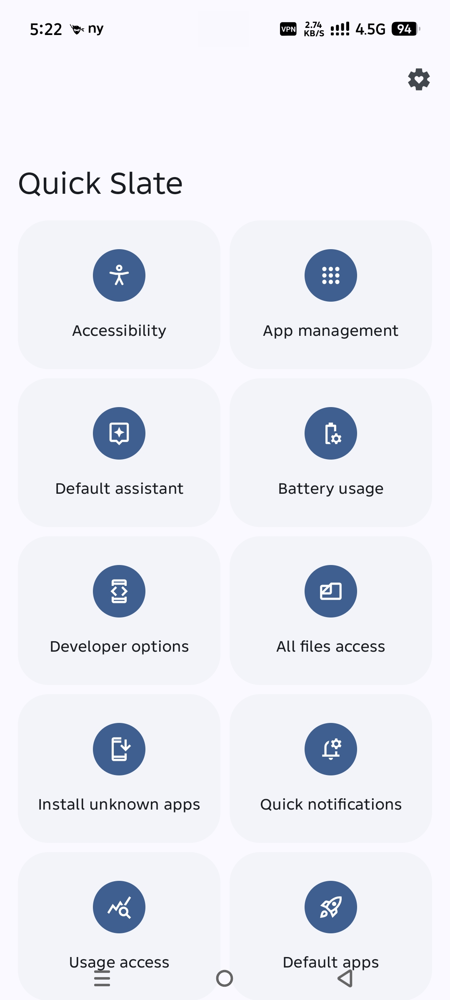
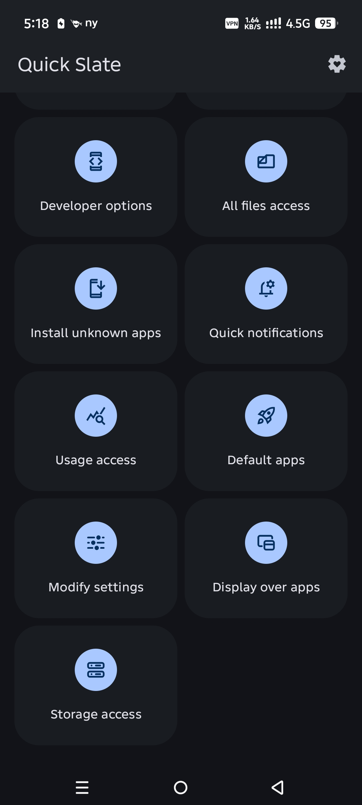
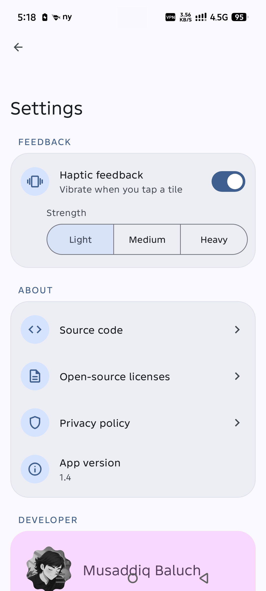
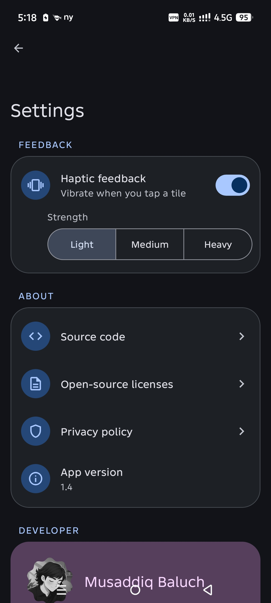

# QuickSlate

  

  <strong>A lightweight Android utility toolkit powered by Quick Settings tiles.</strong>

  
  
  

QuickSlate provides convenient access to essential Android settings through custom Quick Settings tiles. Instead of navigating through multiple menus, you can access supported system settings directly from your notification shade.

Designed with simplicity and efficiency in mind, QuickSlate keeps its functionality focused on shortcuts without requiring a persistent background service.

## Screenshots

  
  

  
  

## Features

- **Quick Settings integration:** Access supported system settings directly from the notification shade.
- **Convenient shortcuts:** Open device settings without navigating through multiple menus.
- **Lightweight:** Focused functionality without unnecessary background processes.
- **Haptic feedback:** Optional touch feedback with configurable intensity.
- **Privacy-focused:** No analytics, tracking, or data collection.
- **Offline operation:** Core functionality works locally without an internet connection.

The availability of individual settings shortcuts may vary depending on the Android version and device manufacturer.

## Installation

1. Open the [Releases](https://github.com/musaddiqbaluch/QuickSlate/releases) page.
2. Download the latest APK.
3. Install the downloaded APK. If prompted, allow your browser or file manager to install unknown apps.
4. Open QuickSlate if needed.
5. Swipe down twice to expand the notification shade.
6. Open the Quick Settings editor using the pencil or Edit button.
7. Find the QuickSlate tiles and drag the shortcuts into your active Quick Settings panel.

Once added, the tiles can be used directly from the notification shade.

## Compatibility

- **Minimum Android version:** Android 8.0 (API 26).
- **Recommended:** Android 10 and later.
- Requires Android support for custom Quick Settings tile services.
- Some shortcuts may behave differently or be unavailable on certain devices due to manufacturer-specific settings implementations.

## Privacy

QuickSlate is designed to operate locally and avoid unnecessary access to user data.

- **No internet access:** The application does not require the Internet permission.
- **No tracking:** No analytics or tracking services are included.
- **No data collection:** QuickSlate does not collect or transmit personal information.
- **Offline functionality:** Its core features operate locally on the device.

## Permissions

QuickSlate requests only the permissions required by its implemented functionality. It does not request broad storage access or unnecessary access to personal data.

## Open Source License

QuickSlate is open-source software distributed under the **MIT License**.

You are free to use, study, modify, and distribute the software in accordance with the license terms.

See the [LICENSE](LICENSE) file for the complete license text.

## Source Code

The source code is available on GitHub:

[https://github.com/musaddiqbaluch/QuickSlate](https://github.com/musaddiqbaluch/QuickSlate)

## Contributions

Bug reports, suggestions, and improvements are welcome. If you encounter an issue, please open a GitHub issue with relevant details, including your Android version and device information when applicable.

---

  Made with care by <a href="https://github.com/musaddiqbaluch">Musaddiq Baluch</a>

